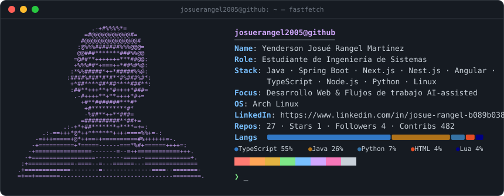
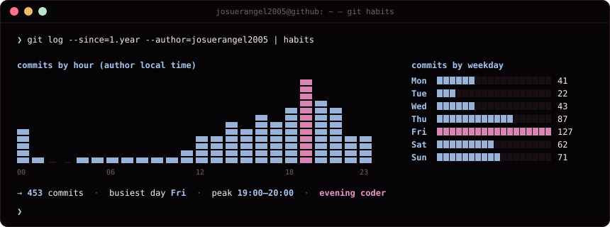

  

  
  

  

  

The card and the habits panel are rendered from <a href="src/">src/</a> and the metrics by
<a href="https://github.com/lowlighter/metrics">lowlighter/metrics</a>, refreshed daily by GitHub Actions.

